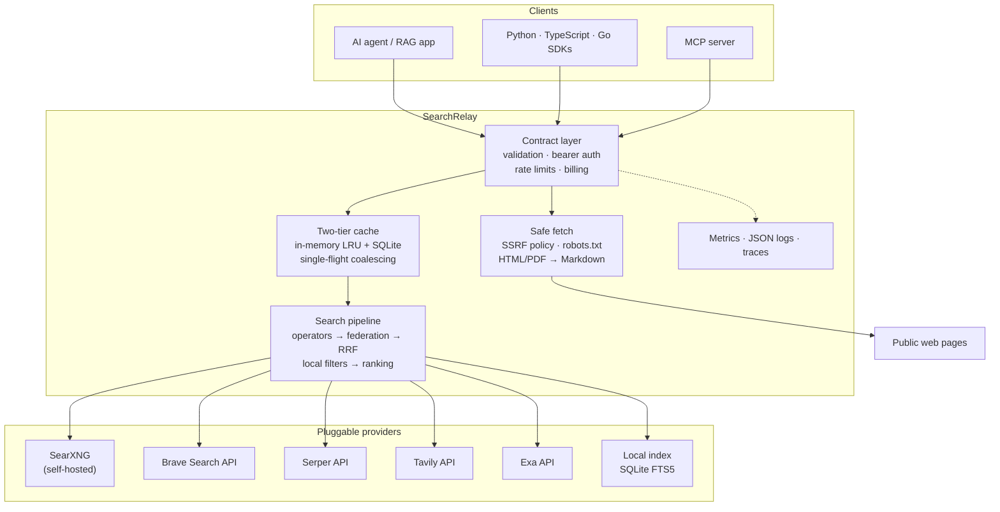

# SearchRelay

[](https://github.com/searchrelay/searchrelay/actions/workflows/ci.yml)
[](https://github.com/searchrelay/searchrelay/releases)
[](LICENSE)
[](pyproject.toml)
[](Dockerfile)
[](docs/)

**SearchRelay is the open, self-hostable web search and fetch layer for AI agents: a DeepSeek-compatible API that federates any search provider — Brave, Serper, Tavily, Exa, your own SearXNG, or your own sites — so you are never locked into one index.**

SearchRelay does not own a web index and does not claim to. It is the layer
between your agent and whatever search corpus you choose to run: it speaks the
DeepSeek Search API shape, enforces operators locally, fuses multiple providers,
extracts clean Markdown, and keeps working when one provider is down.

---

## 30-second quickstart

Requires Docker and Docker Compose. The stack starts the API, a SearXNG
instance, and Redis.

```bash
export SEARCHRELAY_API_KEY="sk-$(openssl rand -hex 24)"
export SEARXNG_SECRET="$(openssl rand -hex 32)"
cat > .env <<EOF
SEARXNG_SECRET=$SEARXNG_SECRET
SR_API_KEYS_JSON={"$SEARCHRELAY_API_KEY":"local-demo"}
SR_INITIAL_BALANCES_JSON={"local-demo":100000000}
EOF

docker compose up --build
```

Ask it something:

```bash
curl -sS http://localhost:8000/v1/tools/search \
  -H "Authorization: Bearer $SEARCHRELAY_API_KEY" \
  -H "Content-Type: application/json" \
  -d '{"query":"site:fastapi.tiangolo.com async def","count":3}'
```

```json
{
  "results": [
    {
      "rerank_score": 1.935,
      "title": "Concurrency and async / await - FastAPI",
      "url": "https://fastapi.tiangolo.com/async/",
      "snippet": "…",
      "summary": "…",
      "content": "",
      "site_name": "fastapi.tiangolo.com",
      "site_icon": "https://fastapi.tiangolo.com/favicon.ico",
      "date": null,
      "authority": 2
    }
  ]
}
```

There is no default API key and no built-in secret: the service refuses to
start until you configure credentials. Check reachability with
`curl -i localhost:8000/healthz` and `curl -i localhost:8000/readyz`.

Prefer to run it yourself? See [`docs/quickstart.md`](docs/quickstart.md) for
the pip install path, key generation, and the provider keys.

---

## How it compares

The honest version. SearchRelay is a **layer**, not an index.

| Capability | SearchRelay | DeepSeek Search | Brave Search API | Tavily | SearXNG |
|---|---|---|---|---|---|
| Self-hostable | **Yes**, you run it | No | No | No | **Yes** |
| DeepSeek-compatible `/v1/tools/search` + `/v1/tools/fetch` | **Yes** | Yes (their own) | No | No | No |
| Owns a web index | No, by design | No | **Yes** (independent index) | No (uses its own crawl + partners) | No |
| Any search provider, pluggable | **Yes** (Brave, Serper, Tavily, Exa, SearXNG, local) | No | No | No | Aggregates many engines |
| Multi-provider fusion (RRF) with failover | **Yes** | No | No | No | No |
| Operators enforced locally after retrieval | **Yes** | No | Partly (upstream only) | Partly | Partly |
| Clean Markdown extraction (HTML, PDF, charset) | **Yes** | Provider-dependent | No | **Yes** (hosted extract) | No |
| Ranking model you can inspect and configure | **Yes** (transparent heuristic, YAML authority tiers) | No | No | No | No |
| Prompt-injection labeling + agent boundary docs | **Yes** | No | No | No | No |
| Built-in per-key billing, budgets, rate limits | **Yes** | No | No | No | No |
| Free to run | **Yes** (self-hosted) | No | No (paid tiers) | No (paid tiers) | **Yes** |
| Pure metasearch over dozens of engines | No (federates a handful of API providers) | No | No | No | **Yes** |

### Where we lose

Stated plainly, because a comparison table that only lists wins is marketing:

- **Against DeepSeek Search:** they have a tuned, first-party pipeline for
  their own models. You give up model-specific tuning, a managed index, and a
  zero-ops experience. We are a replacement for the *API surface*, not for
  their proprietary search work.
- **Against the Brave Search API:** Brave owns an independent index and
  implements operators natively at the source. We do not own an index and we
  enforce operators *after* retrieval, which can drop results an upstream
  would have filtered better. Brave also has dedicated LLM-context endpoints
  that we do not replicate.
- **Against Tavily:** Tavily ships hosted extraction, a deep-research API, and
  agent-oriented ergonomics that work out of the box. Our fetch pipeline is
  yours to run, size, and secure.
- **Against SearXNG:** SearXNG alone is simpler, free, and aggregates dozens of
  engines immediately. SearchRelay adds the API contract, fusion, ranking,
  extraction, caching, and billing — but for general web coverage it still
  needs a SearXNG instance or a paid provider behind it. If all you need is
  "search the web from my own box", SearXNG is the shorter path.
- **Against everyone:** the committed benchmark is a synthetic harness
  self-test, not a live provider quality measurement. We have not published
  live nDCG numbers, and we will not claim quality we have not measured.

### Terms of service

SearchRelay never scrapes Google, Bing, or Brave HTML. It talks to official
provider APIs and to a SearXNG instance **that you run**. SearXNG itself
queries the engines it is configured with; the terms, rate limits, and
legal exposure of those engines are yours to accept. See
[`docs/providers.md`](docs/providers.md).

---

## Architecture



Read it bottom-up: providers return candidates, the pipeline enforces the
operators locally, fuses provider rankings with Reciprocal Rank Fusion, dedupes
by canonical URL, scores results on a transparent 0–3 scale, and the contract
layer bills only successful calls.

---

## Features

- **DeepSeek-compatible contract** for `POST /v1/tools/search` and
  `POST /v1/tools/fetch`: same fields, same error envelope, same billing
  semantics.
- **Provider federation** across Brave Search API, Serper, Tavily, Exa,
  user-run SearXNG, and an optional local index, queried in parallel with
  per-provider timeouts, jittered retries, circuit breakers, budgets, and
  automatic failover. `X-Providers-Used` lists who answered.
- **Operators enforced locally** after retrieval: `site:`, `-site:`, `-term`,
  `-"phrase"`, `"phrase"`, `lang:`, `after:`, `before:`.
- **Two-tier cache** (in-memory LRU + SQLite) with TTLs by content type,
  `ETag`/`Last-Modified` revalidation, and request coalescing so concurrent
  identical queries share one upstream call.
- **Batch search**: `POST /v1/tools/search/batch`, up to ten queries, billed one
  unit per successful query.
- **Clean extraction**: main-content HTML to Markdown with Trafilatura, PDF to
  Markdown, charset detection, preserved tables and code blocks, optional
  Playwright rendering (experimental, off by default).
- **Transparent ranking**: `rerank_score` normalized to 0–3 from authority,
  freshness, quality, relevance, and click prior, with an operator-controlled
  YAML authority list. An optional local ONNX cross-encoder can blend in
  (experimental, off by default) while the heuristic stays the fallback.
- **Safe fetching**: SSRF defense with public-IP-only DNS resolution, DNS
  pinning, redirect revalidation, metadata/private-network blocking, no
  userinfo, restricted ports, and `robots.txt` support.
- **Prompt-injection awareness**: instruction-like content is filtered, every
  response field is documented as untrusted, and responses carry
  `X-Content-Untrusted: true`.
- **Operations**: Prometheus metrics, structured JSON logs with request ids,
  optional OpenTelemetry tracing, Redis-backed shared rate limiting and billing,
  and an admin CLI for keys, budgets, and usage.
- **Agent integration**: MCP server, Python/TypeScript/Go SDKs, a LangChain
  tool, a LlamaIndex reader, and three runnable examples.

---

## API

Authentication is a bearer key on both endpoints:

```http
Authorization: Bearer <key>
Content-Type: application/json
```

Unknown request fields are ignored.

### Search

```bash
curl -sS http://localhost:8000/v1/tools/search \
  -H "Authorization: Bearer $SEARCHRELAY_API_KEY" \
  -H "Content-Type: application/json" \
  -d '{
    "query": "site:python.org asyncio -threading",
    "count": 5,
    "ori_question": "How should I run an async Python web service?",
    "need_content": true
  }'
```

| Field | Type | Notes |
|---|---|---|
| `query` | string, required | 1–128 Unicode characters |
| `count` | integer | 1–50, default 10 |
| `ori_question` | string or null | 1–128 characters; focuses excerpts and summaries |
| `localization` | string or null | IP address used by the search backend when supported |
| `need_content` | boolean | When false, every result's `content` is `""` |

Response:

```json
{
  "results": [
    {
      "rerank_score": 1.82,
      "title": "Page title",
      "url": "https://example.com/page",
      "snippet": "A short UI-oriented excerpt…",
      "summary": "A longer query-focused summary for a model…",
      "content": "# Page title\n\nPage content as Markdown…",
      "site_name": "example.com",
      "site_icon": "https://example.com/favicon.ico",
      "date": "2026-10-25T12:30:00Z",
      "authority": 3
    }
  ]
}
```

No matches return HTTP 200 with `{"results": []}`. Successful responses include
`X-Providers-Used` and `X-Content-Untrusted: true`.

### Batch search

```bash
curl -sS http://localhost:8000/v1/tools/search/batch \
  -H "Authorization: Bearer $SEARCHRELAY_API_KEY" \
  -H "Content-Type: application/json" \
  -d '{"queries":["fastapi background tasks","python asyncio tutorial"],"count":5}'
```

```json
{
  "items": [
    {"query": "fastapi background tasks", "results": [{"rerank_score": 1.9, "title": "…", "url": "…"}], "error": null},
    {"query": "python asyncio tutorial", "results": [], "error": {"message": "…", "type": "invalid_request_error", "param": null, "code": "downstream_timeout"}}
  ]
}
```

Up to ten queries per request. Each query is billed separately, and only a
query that returns a non-empty `results` array is billable. A failing query
carries its own error object; if every query fails, the endpoint returns the
usual error envelope instead of a 200 body.

### Fetch

```bash
curl -sS http://localhost:8000/v1/tools/fetch \
  -H "Authorization: Bearer $SEARCHRELAY_API_KEY" \
  -H "Content-Type: application/json" \
  -d '{"url":"https://example.com/article"}'
```

```json
{
  "title": "Article title",
  "content": "# Article title\n\nClean page content as Markdown…"
}
```

The URL must be HTTP(S), contain a host, contain no userinfo, and be at most
8192 characters.

### Errors

All errors use this envelope:

```json
{
  "error": {
    "message": "Human-readable message",
    "type": "invalid_request_error",
    "param": null,
    "code": "invalid_request"
  }
}
```

| Status | Meaning | Retry? |
|---:|---|---|
| 400 | Invalid JSON, field, query operator, or URL | No |
| 401 | Missing or invalid API key | No |
| 402 | Account has no usable balance | No |
| 403 | URL blocked by the SSRF/security policy | No |
| 404 | Dead URL, robots denial, unsupported type, or no extractable content | No |
| 408 | Downstream response body timed out | Yes |
| 413 | Request or fetched response body is too large | No |
| 429 | Account QPS or per-domain Fetch limit exceeded | Yes |
| 500 | Internal service error | Yes |
| 504 | Search backend or downstream connection timed out | Yes |

### Billing

- Search: **$0.75 per 1,000 successful requests**.
- Fetch: **$0.75 per 1,000 successful requests**.
- A successful Search is billable only when HTTP 200 contains a non-empty
  `results` array.
- A successful Fetch is billable only when HTTP 200 contains non-empty
  `content`.
- Failures, empty Search results, and timeouts are free.
- `count` does not change the price.
- Internally, balances use integer micro-US dollars; one request costs 750
  units.

---

## Configuration

All settings use the `SR_` prefix. Official provider credentials use their
service-standard variables (`BRAVE_SEARCH_API_KEY`, `SERPER_API_KEY`,
`TAVILY_API_KEY`, `EXA_API_KEY`). Only providers listed in
`SR_PROVIDER_PRIORITIES` are queried.

| Variable | Default | Purpose |
|---|---:|---|
| `SR_UPSTREAM_URL` | `http://searxng:8080` | SearXNG base URL |
| `SR_UPSTREAM_TIMEOUT_SECONDS` | `10` | SearXNG provider timeout |
| `SR_PROVIDER_PRIORITIES` | `searxng` | Comma-separated enabled provider priorities |
| `SR_PROVIDER_CONFIG_FILE` | unset | Optional JSON file for provider budgets and settings |
| `SR_PROVIDER_RETRY_ATTEMPTS` | `2` | Attempts per provider search, including the first |
| `SR_PROVIDER_RETRY_BASE_DELAY_SECONDS` | `0.15` | Full-jitter exponential retry base delay |
| `SR_PROVIDER_CIRCUIT_FAILURE_THRESHOLD` | `5` | Failed logical calls before a circuit opens |
| `SR_PROVIDER_CIRCUIT_RESET_SECONDS` | `30` | Delay before a half-open circuit probe |
| `SR_PROVIDER_RRF_K` | `60` | Reciprocal Rank Fusion constant |
| `SR_DATABASE_PATH` | `data/searchrelay.db` | Billing ledger path |
| `SR_CACHE_ENABLED` | `true` | Enable the two-tier cache |
| `SR_CACHE_MEMORY_ENTRIES` | `512` | In-memory LRU capacity |
| `SR_CACHE_DATABASE_PATH` | `data/cache.db` | SQLite cache tier; empty or unset disables it |
| `SR_CACHE_SEARCH_TTL_SECONDS` | `300` | Search result TTL |
| `SR_CACHE_FETCH_TTL_SECONDS` | `3600` | HTML/text fetch TTL |
| `SR_CACHE_PDF_TTL_SECONDS` | `86400` | PDF fetch TTL |
| `SR_API_KEYS_JSON` | `{}` (startup rejects an empty map) | JSON map of bearer key → account ID |
| `SR_INITIAL_BALANCES_JSON` | `{}` | JSON map of account ID → micro-US dollars |
| `SR_KEYS_FILE` | unset | JSON key/balance file |
| `SR_SEARCH_QPS` | `100` | Account-level Search QPS |
| `SR_FETCH_QPS` | `25` | Account-level Fetch QPS |
| `SR_FETCH_DOMAIN_QPS` | `5` | Global per-domain Fetch QPS |
| `SR_PRICE_MICROS_PER_REQUEST` | `750` | Price for one billable request |
| `SR_FETCH_MAX_BYTES` | `5242880` | Maximum fetched response size |
| `SR_FETCH_TIMEOUT_SECONDS` | `12` | Fetch read timeout |
| `SR_FETCH_MAX_REDIRECTS` | `5` | Redirect limit |
| `SR_RESPECT_ROBOTS` | `true` | Honor robots.txt |
| `SR_USER_AGENT` | `SearchRelayBot/1.0` | Fetch user agent |
| `SR_AUTHORITY_CONFIG_FILE` | `config/authority.yaml` | Authority tier configuration |
| `SR_LOCAL_INDEX_PATH` | `data/local-index.db` | SQLite path of the optional private local index |
| `SR_RENDER_JS` | `false` | Enable optional Playwright rendering (experimental) |
| `SR_RENDER_JS_TIMEOUT_SECONDS` | `15` | JavaScript render timeout |
| `SR_RERANK_CROSS_ENCODER_ENABLED` | `false` | Enable the optional ONNX cross-encoder (experimental) |
| `SR_RERANK_CROSS_ENCODER_MODEL` | unset | Model directory with `model.onnx` and `tokenizer.json` |
| `SR_RERANK_CROSS_ENCODER_WEIGHT` | `0.35` | Blend weight of the cross-encoder score |
| `SR_BLOCKED_DOMAINS_CSV` | empty | Comma-separated blocked domains |
| `SR_ALLOWED_DOMAINS_CSV` | empty | Optional comma-separated allowlist |
| `SR_MAX_REQUEST_BODY_BYTES` | `65536` | Maximum API request size |
| `SR_METRICS_ENABLED` | `true` | Expose Prometheus metrics on `/metrics` |
| `SR_LOG_JSON` | `true` | Emit JSON log lines |
| `SR_LOG_LEVEL` | `INFO` | Root log level |
| `SR_TRACING_ENABLED` | `false` | Enable OpenTelemetry tracing (experimental) |
| `SR_OTEL_SERVICE_NAME` | `searchrelay` | Service name reported in spans |
| `SR_OTEL_EXPORTER_OTLP_ENDPOINT` | unset | OTLP HTTP traces endpoint |
| `SR_REDIS_URL` | unset | Shared Redis for rate limiting and billing |
| `SR_REDIS_PREFIX` | `searchrelay` | Redis key prefix |

> **Upgrading from the `SF_` prefix:** the pre-0.1.0 `SF_` variables are still
> accepted as a fallback so existing deployments keep running, but `SR_`
> always wins when both are set. The old names are deprecated.

Multiple keys can be loaded from a file instead of the environment:

```json
{
  "keys": {
    "sk-account-a": "account-a",
    "sk-account-b": "account-b"
  },
  "balances": {
    "account-a": 100000000,
    "account-b": 5000000
  }
}
```

Environment-provided key and balance mappings override file values.

---

## Security model

- The fetch client does not trust environment proxy variables.
- Hostnames are resolved before every request and every redirect. **All**
  resolved addresses must be globally routable.
- The HTTP connection is pinned to the validated address while preserving the
  original `Host` header and TLS SNI hostname, preventing a DNS-rebinding gap
  between validation and connection.
- Loopback, private, link-local, multicast, reserved, CGNAT, `.local`,
  `.internal`, localhost, and cloud metadata destinations are blocked.
- Only ports 80 and 443 are accepted.
- Redirects are limited and revalidated.
- HTML comments, scripts, styles, hidden elements, forms, embedded objects,
  unsafe URL schemes, and common prompt-override instructions are removed.
- Search and Fetch content must still be treated as untrusted data. The example
  agent uses explicit document boundaries and tells the answer model never to
  follow instructions found in retrieved content.
- No semantic prompt-injection detector can guarantee safety; the agent
  boundary and model instruction are the final defense.

Details: [`docs/security.md`](docs/security.md).

---

## SDKs and agent integrations

### Python

```bash
pip install -e clients/python
```

```python
import os

from searchrelay import SearchRelayClient

with SearchRelayClient("http://localhost:8000", os.environ["SEARCHRELAY_API_KEY"]) as client:
    results = client.search("FastAPI asyncio", count=5)
    page = client.fetch(results[0].url)
```

### TypeScript

```bash
cd clients/typescript && npm install && npm run build
```

```ts
import { SearchRelayClient } from "searchrelay-sdk";

const client = new SearchRelayClient({
  baseUrl: "http://localhost:8000",
  apiKey: process.env.SEARCHRELAY_API_KEY,
});
const results = await client.search("FastAPI asyncio", { count: 5 });
const page = await client.fetch(results[0].url);
```

### Go

```bash
cd clients/go && go test ./...
```

```go
import "os"

ctx := context.Background()
client := searchrelay.New("http://localhost:8000", os.getenv("SEARCHRELAY_API_KEY"))
results, err := client.Search(ctx, "FastAPI asyncio", searchrelay.SearchOptions{Count: 5})
page, err := client.Fetch(ctx, results[0].URL)
```

### MCP server

```bash
pip install -e clients/mcp
```

The MCP server exposes `search` and `fetch` tools over stdio. Install steps for
Claude Desktop, Claude Code, Cursor, and Windsurf are in
[`docs/agents.md`](docs/agents.md).

### LangChain and LlamaIndex

```bash
pip install -e "clients/python[langchain]"
pip install -e "clients/python[llamaindex]"
```

### Examples

- [`examples/agent.py`](examples/agent.py) — cited answer from live pages.
- [`examples/deep_research.py`](examples/deep_research.py) — multi-round
  research loop.
- [`examples/streamlit_app.py`](examples/streamlit_app.py) — Streamlit demo.

---

## Operations

```bash
searchrelay-admin create-key --account demo --balance 100000000
searchrelay-admin usage
curl -s http://localhost:8000/metrics | head
```

Metrics, structured logs, tracing, shared Redis backends, the admin CLI, and
the container images are documented in [`docs/operations.md`](docs/operations.md).

---

## Benchmarks

`benchmarks/` contains a reproducible harness and a 100-query golden set
(factual, news, code, multilingual). The committed report is a **synthetic
harness self-test** — it proves the harness and the metric implementation
work, and it is **not** evidence about Brave, Serper, Tavily, Exa, or SearXNG
quality.

| Mode | Provider | Queries | nDCG@10 | p50 latency | p95 latency | Failure rate |
|---|---|---:|---:|---:|---:|---:|
| provider | synthetic-brave | 100 | 1.0000 | 0.0 ms | 0.1 ms | 0.00% |
| provider | synthetic-serper | 100 | 1.0000 | 0.0 ms | 0.1 ms | 0.00% |
| provider | synthetic-tavily | 100 | 1.0000 | 0.0 ms | 0.1 ms | 0.00% |
| provider | synthetic-exa | 100 | 1.0000 | 0.0 ms | 0.1 ms | 0.00% |
| provider | synthetic-searxng | 100 | 1.0000 | 0.0 ms | 0.1 ms | 0.00% |
| federated | federated | 100 | 1.0000 | 0.9 ms | 2.3 ms | 0.00% |

Reproduce the self-test:

```bash
python -m benchmarks.run --self-test \
  --providers brave,serper,tavily,exa,searxng \
  --output benchmarks/results/self-test.json --markdown docs/benchmarks.md
```

A live quality run needs real provider credentials:

```bash
python -m benchmarks.run \
  --providers brave,serper,tavily,exa,searxng \
  --output benchmarks/results/live.json --markdown docs/benchmarks.md
```

Load test (Locust):

```bash
export SEARCHRELAY_API_KEY=sk-test
locust -f benchmarks/load_test.py --host http://127.0.0.1:8000 \
  --users 20 --spawn-rate 5 --run-time 2m --headless
```

Full report, method, and limitations: [`docs/benchmarks.md`](docs/benchmarks.md).

---

## Development

```bash
python3.12 -m venv .venv
.venv/bin/pip install -e '.[dev]'
.venv/bin/pytest
.venv/bin/ruff check .
.venv/bin/mypy
.venv/bin/python -m compileall -q app clients/python examples
.venv/bin/python scripts/export_openapi.py /tmp/openapi.json
cd clients/go && go test ./...
```

The documentation site is MkDocs Material and builds in strict mode, so a
broken internal link fails the build:

```bash
.venv/bin/mkdocs build --strict --site-dir /tmp/searchrelay-site
.venv/bin/mkdocs serve   # live preview on http://127.0.0.1:8000/ (docs only)
```

The test suite uses mocked upstream HTTP responses, so it needs neither internet
access nor a running SearXNG instance. CI runs lint, types, tests, the
benchmark harness self-test, the TypeScript and Go SDK tests, and a Docker
build.

---

## Project layout

```text
app/                    FastAPI service
  providers/            SearchProvider interface, adapters, federation, reliability
  local_index/          Optional private crawler and SQLite FTS5 index
clients/python/         Python SDK (+ LangChain tool, LlamaIndex reader)
clients/typescript/     TypeScript SDK
clients/go/             Go SDK
clients/mcp/            MCP server (stdio) for agent clients
examples/               Cited-answer agent, deep-research loop, Streamlit demo
benchmarks/             Harness, golden set, Locust load test
scripts/                Admin CLI, OpenAPI export
config/authority.yaml   Authority tier configuration
deploy/searxng/         SearXNG container configuration
docs/                   Documentation site sources
tests/                  Contract, security, billing, limit, and provider tests
```

---

## Contributing, security, and license

- Contributions: [`CONTRIBUTING.md`](CONTRIBUTING.md) — and see
  [`docs/good-first-issues.md`](docs/good-first-issues.md) for the good-first-issue tasks
  you can pick up.
- Security reports: [`SECURITY.md`](SECURITY.md). Please do not open a public
  issue for a vulnerability.
- Code of conduct: [`CODE_OF_CONDUCT.md`](CODE_OF_CONDUCT.md).
- Changelog: [`CHANGELOG.md`](CHANGELOG.md).
- License: [Apache-2.0](LICENSE).

SearchRelay is an independent project. It is not affiliated with, endorsed by,
or operated by DeepSeek, Brave, Tavily, Exa, or the SearXNG project.
