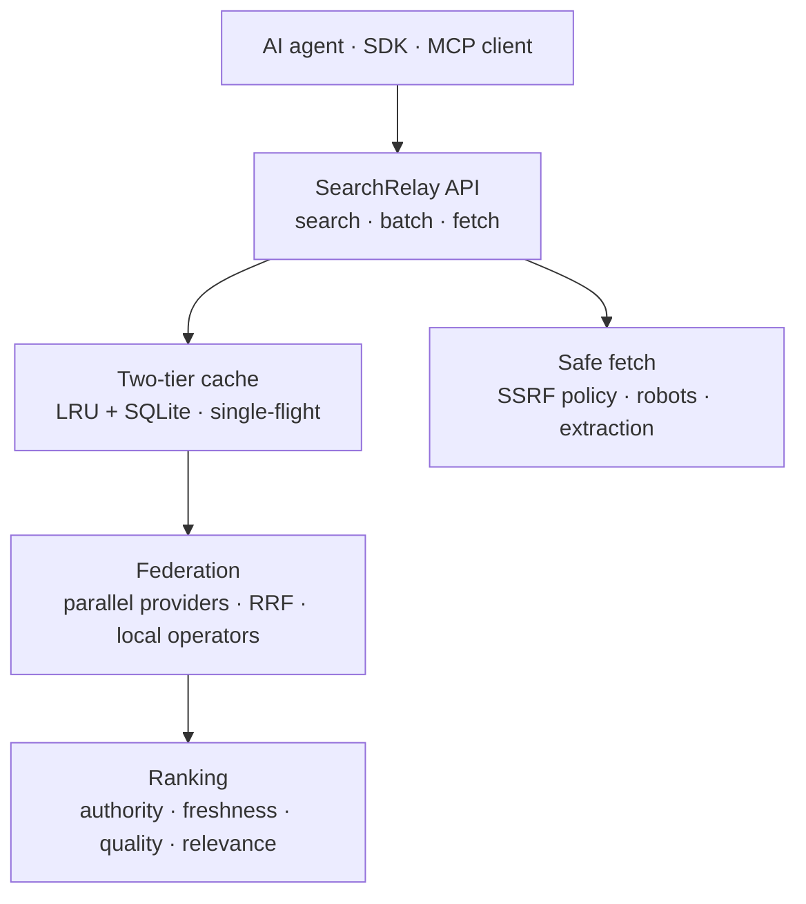

# SearchRelay

**The open, self-hostable web search and fetch layer for AI agents.** A
DeepSeek-compatible API that federates any search provider — Brave, Serper,
Tavily, Exa, your own SearXNG, or your own sites — so you are never locked
into one index.

SearchRelay does not own a web index and does not claim to. It is the layer
between your agent and whatever search corpus you choose to run.

## Start here

- [Quickstart](quickstart.md) — running the service in 30 seconds with Docker,
  or from a pip install.
- [API reference](api.md) — request and response shapes, errors, billing, and
  headers.
- [Providers](providers.md) — how to enable Brave, Serper, Tavily, Exa,
  SearXNG, and the local index, plus the terms-of-service tradeoffs.
- [Security model](security.md) — the SSRF boundary and the prompt-injection
  posture.
- [Deployment](deployment.md) — containers, environment, scaling, and backups.
- [FAQ](faq.md) — the questions people ask first, answered honestly.

## How it works

A search request is parsed for operators, dispatched to every enabled provider
in parallel, fused with Reciprocal Rank Fusion, deduplicated by canonical URL,
filtered again locally (so an upstream that ignores `site:` cannot leak
results), and scored on a transparent 0–3 scale. A fetch request goes through
the SSRF policy, honors `robots.txt`, and returns clean Markdown.

## What is real today

| Area | Status |
|---|---|
| DeepSeek-compatible search/fetch contract | Implemented and tested |
| Provider federation, RRF, failover, circuit breakers | Implemented and tested |
| Local operator enforcement and date filters | Implemented and tested |
| Two-tier cache, revalidation, request coalescing | Implemented and tested |
| Batch search | Implemented and tested |
| Safe fetching, extraction, PDF→Markdown | Implemented and tested |
| Ranking heuristic and YAML authority tiers | Implemented and tested |
| Metrics, JSON logs, tracing, Redis backends, admin CLI | Implemented and tested |
| MCP server, Python/TypeScript/Go SDKs, LangChain, LlamaIndex | Implemented and tested |
| Optional private local index (SQLite FTS5) | Implemented and tested |
| Benchmark harness and 100-query golden set | Implemented; the committed report is a **synthetic self-test**, not live provider quality |
| Playwright rendering and ONNX cross-encoder | Optional, experimental, off by default, no model shipped |
| Live provider quality numbers | **Not measured.** See [Benchmarks](benchmarks.md) |

## Design rules this project follows

1. **No index claims.** SearchRelay is a layer. It queries providers you
   configure and never pretends to rank the whole web.
2. **No HTML scraping of Google, Bing, or Brave.** Official provider APIs and
   a SearXNG instance *you* run are the supported corpora.
3. **No unverified claims.** The benchmark report says exactly what was
   measured, and what was not.
4. **Untrusted content stays labeled.** Every response field is documented as
   third-party content and responses carry `X-Content-Untrusted: true`.
5. **Fail loudly at startup.** Missing keys, malformed authority files, and
   missing reranker models stop the service with an actionable message instead
   of failing later in production.
